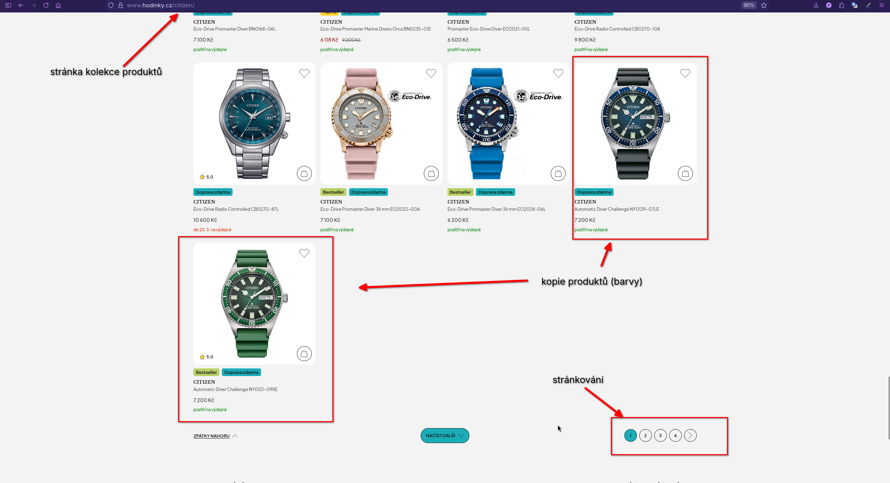
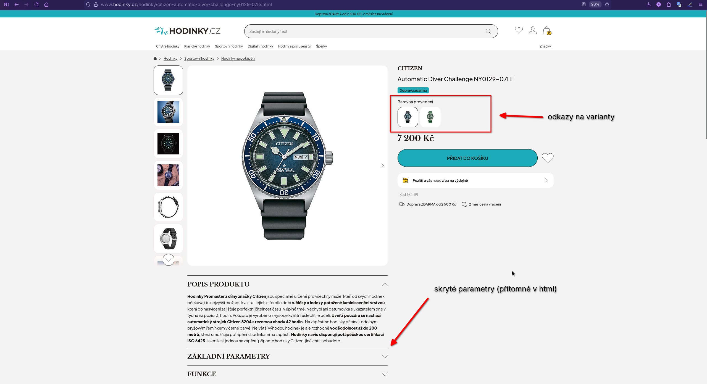

== Úkol 1 -- Data Acquisition - Web Crawler/Scraper

У цьому завданні ціллю було імплементувати crawler/scraper для обраного вебсайту.
У цій роботі було обрано веб-магазин `hodinky.cz`, де метою скрапінгу є збір інформації
про наявні годинники різних брендів.

=== Формуляція завдання, опис ресурсу

Ціллю є створення скрапера, який на основі набору посилань на колекції годинників
(відносно категорій, напр. `{base}/citizen`, `{base}/seiko`) збере визначену кількість
продуктів (наприклад: обробити 5 сторінок, по 4 продукти на кожній).

Головним джерелом даних є веб-магазин `hodinky.cz`, оскільки він надає широкий вибір
годинників різних брендів та має зрозумілу ієрархічну структуру сторінок.

Основними сторінками, що використовуються під час скрапінгу, є:

- сторінки колекцій (категорій), які містять список продуктів
- сторінки конкретних продуктів, що містять детальну інформацію про годинник
та можливі варіанти (наприклад, різні кольори циферблата)

На основі структури сайту процес збору даних виглядає наступним чином:

1. для кожної `start_url` (напр. `/seiko`) отримати список продуктів зі сторінки колекції (див. рис. <<#img:collection-page-ann, 1>>)
2. обрати продукт зі списку та зробити запит на його сторінку
3. на сторінці продукту (рис. <<#img:product-page-ann, 2>>) знайти доступні варіанти (наприклад різні кольори) та зробити запити на них
4. після отримання інформації про продукт і всі його варіанти відфільтрувати список продуктів
(оскільки варіанти можуть також з'являтися у списку продуктів на сторінці колекції)
5. після досягнення ліміту продуктів для поточної сторінки колекції перейти на наступну сторінку
6. після досягнення ліміту сторінок колекції завершити роботу краулера


.Příklad stránky kolekce produktů
[#img:collection-page-ann]


.Příklad stránky produktu
[#img:product-page-ann]


=== Правила сайту
На сайті доступний файл `robots.txt`. У ньому заборонені лише деякі сторінки,
пов'язані з користувацькими діями (наприклад `kosik`, `mailing`).
Обмеження для скрапінгу категорій продуктів або сторінок товарів відсутні.

У файлі `robots.txt` також не вказані спеціальні параметри для ботів
(наприклад crawl-delay). Додатково сайт надає файл `sitemap.xml`.

На деяких сторінках продуктів також використовуються HTML meta теги `robots`,
які дозволяють індексацію сторінок (`index`).

=== Можливості отримання даних
Сайт надає розширений файл `sitemap.xml`, який містить посилання на всі
категорії продуктів та окремі сторінки товарів. У межах цієї роботи
ця інформація не використовується, оскільки crawler отримує сторінки
через навігацію по категоріях.

На сторінках продуктів також присутні додаткові машинно-читані дані:

- **OpenGraph теги**

- `og:description` — короткий опис сторінки продукту
- `og:image` — посилання на головне зображення продукту
- `og:title` — назва сторінки (містить назву продукту та назву сайту)

  Однак ці дані є обмеженими та не містять детальної інформації про продукт.

- **JSON-LD дані**

  На деяких сторінках присутні структуровані дані у форматі JSON-LD.
  На жаль, вони не є повними (частина полів може бути відсутня) та загалом поля різняться між сторінками.


З оглядом на це, основна інформація про продукт отримується безпосередньо
з HTML структури сторінки.


=== Вихідні дані (структура)
Список продуктів, зібраний поміж усіма `start_url`.
Кожен продукт містить основну інформацію (назву, бренд, ціну, матеріали, функції),
а також список можливих варіантів, які відрізняються окремими характеристиками
(наприклад кольором циферблата).

```json
{
  "url": "https://www.hodinky.cz/hodinky/citizen-eco-drive-classic-fe2110-81a.html",
  "currency": "Kč",
  "price": 3456,
  "image_url": "https://img.vivantiscdn.net/photos/w400_h400_fN/h/_orig/CI/citizen-eco-drive-classic-fe2110-81a_14908872084452.jpg",
  "case_material": "ocel",
  "strap_material": "ocel",
  "strap_color": "stříbrná",
  "dial_color": "stříbrná",
  "title": "Eco-Drive Classic FE2110-81A",
  "brand": "Citizen",
  "functions": [
    "vodotěsnost"
  ],
  "variants": [
    {
      "url": "https://www.hodinky.cz/hodinky/citizen-eco-drive-classic-fe2110-81l.html",
      "currency": "Kč",
      "price": 3664,
      "image_url": "https://img.vivantiscdn.net/photos/w400_h400_fN/h/_orig/CI/citizen-eco-drive-classic-fe2110-81l_14908987081513.jpg",
      "case_material": "ocel",
      "strap_material": "ocel",
      "strap_color": "stříbrná",
      "dial_color": "modrá",
      "title": "Eco-Drive Classic FE2110-81L",
      "brand": "Citizen",
      "functions": [
        "vodotěsnost"
      ]
    }
  ]
}
```


=== a
1. gonna crawl hodinky.cz for a few categories e.g. /citizen /senko
    - there is global robots.txt
        - allows bots
        - provides sitemap with all product links (for seek of demo, not using it)
        - no specific bot headers in responses

2. handle pagination and product link extraction
3. product extraction
    - on each product page there is robots tags inside of html, allowed for indexing
    - there is Opengraph tags on the page but their information is limited
        - op:description: contains very short description of product page (not sufficient to judge product)
        - op:image: contains link to main product image
        - op:title: contains title of page (tab), apart from product name has website name listed
    - there is JSON LD data
        - information is not full and not consistent between pages (can be missing, or have missing fields)
        - does not contain specification only price and name of product

    - fields
        [image, price, title, product variants, Materiál pouzdra, Materiál řemínku, Barva řemínku/tahu, Barva ciferníku]
        [set of additional function]
    - [important] have to deduplicate by product variants
        - product variant has to have
            - colors/materials of pouzdra, reminku, ciferniku
            - link to it