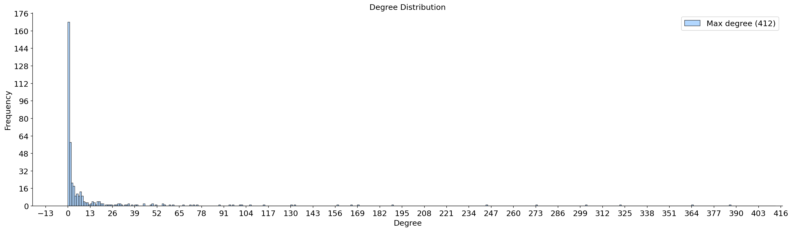
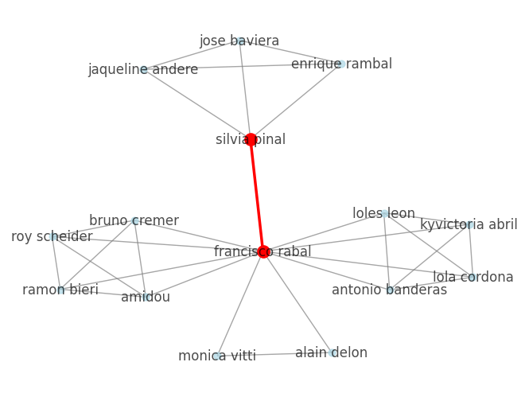

== 3. Social Network Analysis

Pro splnění úkolu byl použit movie dataset dostupný na adrese  https://archive.ics.uci.edu/ml/datasets/Movie:[Movie dataset].
Konkrétně byla použita data o filmech a hercích dostupná v souboru `casts.html`.
Graf tedy obsahuje uzly představující herce a hrany spojují herce, kteří hráli ve stejném filmu
(pokud měl herec více rolí ve stejném filmu, "self" hrana se nevytváří).

Extrakci a vytvoření grafu naleznete v souboru `src/actors_graph.py`.

=== Základní statistika
Vytvořený graf obsahuje 15849 uzlů a 144084 hran.
Hustota grafu je 0.00115, teda siť je velmi řídka, což odpovídá očekávání,
protože většina herců spolu nikdy nehrála.

Průměrný koeficient klastrování dosahuje hodnoty 0.717. To naznačuje,
že pokud dva herci spolupracovali se stejným hercem, je vysoká pravděpodobnost,
že spolu hráli i přímo. Tento jev je taky očekavan s ohledem na konstrukce grafu (plne propojeni v ramci jednoho filmu).

Graf je rozdelen do 731 komponent, udaje o rozdeleni uzlu dle komponent je videt v tabulce nize.
Je videt ze nejvetsi kopmonenta obsahuje 0.89 vsech uzlu grafu, coz naznacuje ze vse herci tvori velkou propojenou komunitu.
Vetsinu tohoto poctu tvori komponenty s poctem uzlu do deseti, to muze odpovidat napr. lokalnim filmam
z Europy. Druhu polovicu poctu tvori singletonove komponenty, ktere odpovida napr. bibliographie nebo jsou jinak soustredene na jednem cloveku (teda "staring").
Pro priklad, Thais s hercem Thais Galizky je sole surviving Italian Futurist film.

==== Komponenty

[cols="2,1", options="header"]
|===
| Metrika | Hodnota

| Počet komponent
| 731

| Velikost největší komponenty
| 14 062

| Podíl největší komponenty
| 0.887 (≈ 88.7 %)

| Počet singletonů (velikost 1)
| 322

| Počet malých komponent (2–10 uzlů)
| 400

| Počet středních komponent (11–100 uzlů)
| 8

| Počet velkých komponent (>100 uzlů, mimo největší)
| 0

|===

Graf je rozdělen do 731 komponent, přičemž rozdělení jejich velikostí je uvedeno v tabulce výše.

Největší komponenta obsahuje přibližně 88.7 % všech uzlů, což naznačuje, že většina herců tvoří jednu velkou propojenou síť (což odpovída očekavaní).
Zbytek grafu tvoří převážně malé komponenty. Největší část z nich představují komponenty o velikosti do 10 uzlů, které mohou odpovídat například menším nebo lokálním filmovým produkcím.

Významnou část tvoří také singletony (322 uzlů), tedy herci bez vazeb na ostatní. Ty mohou reprezentovat například bibliografie, specifické projekty zaměřené na jednoho herce nebo neúplná data.
V datech se například vyskytuje film "Thais" s herečkou Thais Galizky (film soustreden na jedne pani).

==== Stupně uzlů, mosty

Na obrázku výše je uvedeno rozdělení stupně uzlů. Je vidět, že většina uzlů má malý stupeň (typicky do deseti), zatímco pouze malé množství uzlů dosahuje vysokých hodnot (nad 100).
Toto chování odpovídá rozdělení typu *power law*.

Níže jsou uvedeny top 5 uzlů dle stupně, všechny představují známé herce z období tvorby datasetu.

[cols="2,1", options="header"]
|===
| Herec | Stupeň

| Humphrey Bogart
| 412

| Gary Cooper
| 358

| James Stewart
| 357

| John Gielgud
| 356

| John Carradine
| 354

|===

Graf obsahuje celkově 438 mostů. Většinou se však jedná o mosty prvního stupně (tedy připojují listy). Mostů mezi uzly s vyšším stupněm je pouze 7; graf jednoho z nich je uveden níže.

=== Centralita
.Degree centralita
[cols="2,1", options="header"]
|===
| Herec | Hodnota metriky

| Humphrey Bogart
| 0.02599861172461665

| Gary Cooper
| 0.022591026692749417

| James Stewart
| 0.022527923266233357

| John Gielgud
| 0.022464819839717296

| John Carradine
| 0.02233861298668518

| Peter Lorre
| 0.0218337855745567

| C. Aubrey Smith
| 0.020571717044235504

| Henry Fonda
| 0.019688269073010665

| Burt Lancaster
| 0.019057234807850067

| David Niven
| 0.018931027954817947

|===

.Closeness centralita
[cols="2,1", options="header"]
|===
| Herec | Hodnota metriky

| Charlton Heston
| 0.3444204686806322

| John Gielgud
| 0.3437277752290057

| Burt Lancaster
| 0.3431038983991206

| Henry Fonda
| 0.34006451857520775

| John Carradine
| 0.33975891335985464

| David Niven
| 0.3383675162043616

| James Stewart
| 0.3374158118100179

| Robert Mitchum
| 0.33645129867556284

| Robert De Niro
| 0.33513181093497424

| Laurence Olivier
| 0.33512280903293723

|===

.Betweenness Centralita
[cols="2,1", options="header"]
|===
| Herec | Hodnota metriky

| Robert De Niro
| 0.011315137095846394

| John Carradine
| 0.01086691513863796

| Vincent Price
| 0.010764103931666874

| Humphrey Bogart
| 0.010686893357448995

| Burt Lancaster
| 0.01057764571087529

| Gene Hackman
| 0.009937017131140062

| John Gielgud
| 0.009453148331635056

| Charlton Heston
| 0.009323707105524007

| Jack Nicholson
| 0.00887439303377209

| James Stewart
| 0.008032388751603566

|===

.Eigenvector Centralita
[cols="2,1", options="header"]
|===
| Herec | Hodnota metriky

| C. Aubrey Smith
| 0.10485028886498275

| John Carradine
| 0.09881481860018791

| Peter Lorre
| 0.09295870749885816

| James Stewart
| 0.09258502168958771

| John Gielgud
| 0.09131177574071166

| Gary Cooper
| 0.09023493963125748

| David Niven
| 0.08839774672650973

| Basil Rathbone
| 0.08822845125407812

| Andy Devine
| 0.08588618791107584

| Henry Fonda
| 0.08437356735112676

|===

Každý z přístupů poskytuje mírně odlišné výsledky, přičemž v top 10 se ve všech metrikách objevují pouze tři herci – James Stewart, John Carradine a John Gielgud.

Z výsledků degree a closeness centrality je vidět, že i když má herec mnoho přímých spojení, mohou stále existovat části sítě, které jsou od něj relativně vzdálené (např. Humphrey Bogart).

Naopak closeness a betweenness centralita mají mezi sebou větší shodu, což odpovídá intuitivní představě, že uzly, kterými prochází více nejkratších cest, bývají zároveň "blíže" ostatním uzlům v síti.

Největší odlišnost vykazuje eigenvector centralita, která zohledňuje nejen počet spojení, ale i jejich význam. Přesto i zde dominují uzly s vysokým stupněm.

### Top komunity

Pro detekci komunit byl použit algoritmus Louvain, který optimalizuje modularitu grafu a efektivně identifikuje hustě propojené skupiny uzlů.
Alternativní metody, jako například Kernighan–Lin algoritmus nebo Clique Percolation Method, protoze jsou citlive na vyber parametrů (hloubka rekuze, rozmer kliky).

Graf je rozdělen celkově do 788 komunit (oproti 731 souvislým komponentám). Vetsinu z nich tvori komunity pod 10 herců,
Většinu z nich tvoří malé komunity o velikosti do 10 herců, které často odpovídají samostatným souvislým komponentám (viz sekce o komponentách).

Současně se v grafu nachází několik výrazně větších komunit, konkretně 4 komunity s více než 1000 uzly a 13 komunit s více než 100 uzl.

Takze sice graf obsahuje "giganskou" komponentu obsahujici vice nez 80% uzlu, stale herci tesne komunikuji jen ve svem okoli (v ramce par filmů).
Takže přestože graf obsahuje jednu dominantní komponentu zahrnující více než 80 % uzlů, výsledky ukazují, že herci jsou ve skutečnosti organizováni
do menších, relativně těsně propojených skupin.

Obrazky nebyly pridane pro velikost komunit.
