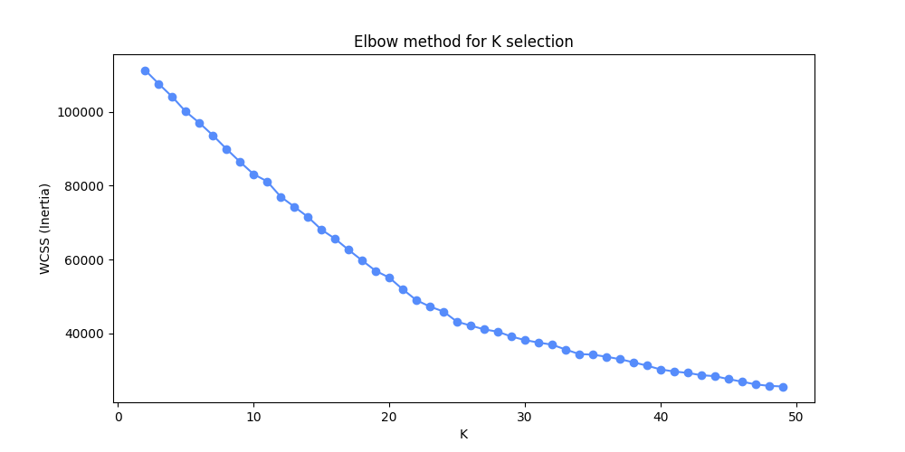

== 4. Web Analytics / Web Usage Mining
Pro splnění úlohy byl použit poskytnutý dataset:
https://courses.fit.cvut.cz/NI-DDW/hw/04/files/wum-dataset-hw.zip[wum-dataset-hw.zip].

Dataset obsahuje tři tabulky:

* *clicks*:
** informace o zobrazeních stránek v rámci relací
** atributy: PageName, CatName, ExtCatName, TopicName, TimeOnPage, SequenceNumber, ...
* *visitors*:
** informace o relacích
** atributy: Length_seconds, Length_pagecount, Referrer, Day, Hour
* *search_engine_map*:
** mapování referreru na typ zdroje

Další sekce pokračují popisem datasetu a použitých metod, celý průběh práce je také možné sledovat
v `notebooks/main.ipynb`

---

=== Analýza dat a výběr relevantních atributů

Data obsahují přibližně:

* 15 559 relací (VisitID)
* 38 451 interakcí (clicks)

Klíčovými atributy pro analýzu jsou:

* VisitID — identifikátor relace
* PageName — název stránky
* CatName — obecná kategorie
* ExtCatName — detailnější kategorie
* TopicName — tematická kategorie
* SequenceNumber — pořadí přechodů

Pomocné atributy (PageID, CatID, TopicID, LocalID) jsou pouze interní identifikátory a nenesou analytickou hodnotu, proto byly odstraněny.

---

==== Analýza atributu PageName

Atribut *PageName* obsahuje přibližně 800 unikátních hodnot.

Kvůli vysoké kardinalitě:

* není vhodný pro přímé použití v association rule mining (nízký support)
* obsahuje mnoho šumových nebo technických stránek

Přesto je využit pro identifikaci konverzí.

===== Definované konverze

[cols="1,2"]
|===
|Typ |Konverze

|Makro konverze
|APPLICATION, CATALOG

|Mikro konverze
|INSURANCE, DISCOUNT, WHOWEARE, HOWTOJOIN, LASTMINUTE
|===

Mapování:

[source,python]
----
PAGE_TO_APRIORI_CONVERSION = {
    "APPLICATION": "VIEW_APPLICATION",
    "CATALOG": "VIEW_CATALOG",

    "INSURANCE": "VIEW_INSURANCE",
    "DISCOUNT": "VIEW_DISCOUNT",
    "WHOWEARE": "VIEW_WHOWEARE",
    "HOWTOJOIN": "VIEW_HOWTOJOIN",
    "LASTMINUTE": "VIEW_LASTMINUTE"
}
----

---

==== Analýza kategorií stránek

===== CatName

Obsahuje pouze 5 hodnot:

[cols="1"]
|===
|CatName
| Info, Search, Trip, Application, undetected
|===

Nevýhody:

* příliš obecné
* nízká informativnost

---

===== ExtCatName

Obsahuje detailnější kategorie:

[cols="1"]
|===
|ExtCatName

|homepage, Application, Insurance Catalog, Send catalog, Sales, Who we are, extension, list_tour, KW, Country ...
|===

Problémy:

* mnoho hodnot s velmi nízkou četností (< 100)
* část je technická nebo nejasná (`extension`, `KW`)
* velká část duplikuje informaci z PageName

Proto CatName a ExtCatName nepřidávají podstatnou informaci při ználosti PageName a dále se nepoužívají.

---

==== Analýza TopicName

TopicName je nejvíce informativní atribut, který odráží záměr uživatele.

Seznam relevantních hodnot:

* Tourism, Hiking, VHT, Water, rafting, exotica, Corsica, Stays with trips, hotelbuses, Lastminute, Tours with accommodation, challenging expedition, Ski, Lipari, cyclo, Bulgaria, Tours with lightweight tourism, School tours, Holiday Shipping, Tourist, climbing school, Montenegro, Alps, Golf.

Odstraněné (neinformativní):

* In general, Neni, undetected.

Důvod:

* nenesou jasný význam
* odpovídají informačním nebo šumovým stránkám

---

==== Zpracování času relací

Čas relace je dostupný ze dvou zdrojů:

* součet TimeOnPage (clicks)
* Length_seconds (visitors)

Byla zjištěna nekonzistence, že značná část relací (~9 992) má Length_seconds = 0, přitom jednotlivé stránky mohou mít nenulový čas
Takže jako "zdroj pravdy" je použita tabulka *visitors*.

---

==== Souhrnná statistika po filtrování

[cols="2,1"]
|===
|Metrika |Počet

|Relace s >=2 stránkami
|~6600

|Relace po filtrování
|~5600

|Relace s VIEW_APPLICATION
|16

|Relace s VIEW_CATALOG
|455
|===

---

==== Závěry

* Hlavní informativní atributy jsou:
** TopicName (záměr)
** PageName (konverze)

* Kategorie stránek byly odstraněny kvůli:
** nízké informativnosti
** duplicitě informací
** šumu

* Data obsahují значné množství nekonzistencí, zejména v čase

* Konverze APPLICATION je velmi vzácná, což komplikuje tvorbu pravidel

* Konverze CATALOG je hlavní cíl další analýzy

=== Reprezentace dat a předzpracování

Pro tvorbu asociačních pravidel byla zvolena "semantická" reprezentace relací.
Místo klasických mezikroků (User-Pageview Matrix nebo Page Feature Matrix) je přímo vytvářena Transaction-Feature Matrix (TFM),
kde každá transakce je množina relevantních znaků relace.

Prvky transakce jsou vytvářeny podle těchto pravidel:

* Témata stránek: hodnoty z `TopicName` (prefix `TOPIC_`)
* Konverze: makro a mikro konverze (definované výše) (prefix `VIEW_`)
* Behaviorální znaky: přidány agregované charakteristiky relace, jako počet unikátních témat (`TOPICS>=N`) a počet vyhledávání (`SEARCH>=N`)

Příklad transakce:
----
{'TOPICS>=2', 'SEARCH>=3', 'TOPIC_LIPARI', 'VIEW_DISCOUNT', 'VIEW_CATALOG', 'TOPIC_STAYS_WITH_TRIPS'}
----

Pro čištění dat se provádí:

* odstranění příliš krátkých návštěv
** `Length_pagecount >= 2 AND Length_seconds > 0`
* normalizace registru pro TopicName, PageName
* nahrazení mezer podtržítkem
* odstranění NaN

Po vytvoření transakcí jsou také odstraněny všechny, obsahující pouze jednu akci
(takové vznikají např. z přechodu HOME do CATALOG a pod).

=== Extrakce asociačních pravidel

Pro hledání asociačních pravidel byl použit algoritmus Apriori (knihovna `mlxtend`).

Cílem bylo najít vzory chování vedoucí k makrokonverzi `VIEW_CATALOG`.
Konverze `VIEW_APPLICATION` je velmi vzácná, proto pro ni nebylo možné získat
dostatek pravidel.

Protože `VIEW_CATALOG` se vyskytuje přibližně v ~400 z ~5200 relací,
byly použity nízké prahy:

* `min_support = 0.001` (~5 transakcí)
* `min_confidence = 0.2`

Výsledkem je 37 pravidel s pravou stranou `VIEW_CATALOG`.

---

==== Nejvýznamnější pravidla

[cols="3,1,1,1"]
|===
|Antecedent |Support |Confidence |Lift

|(VIEW_WHOWEARE, TOPIC_ALPS)
|0.0021
|0.636
|8.70

|(TOPIC_TOURISM, VIEW_DISCOUNT, TOPIC_TOURS_WITH_ACCOMMODATION)
|0.0025
|0.462
|6.31

|(VIEW_WHOWEARE, TOPIC_TOURS_WITH_ACCOMMODATION)
|0.0038
|0.450
|6.15

|(VIEW_LASTMINUTE, VIEW_DISCOUNT, TOPIC_TOURS_WITH_ACCOMMODATION)
|0.0027
|0.429
|5.86

|(TOPIC_HIKING, VIEW_WHOWEARE)
|0.0040
|0.333
|4.56

|(TOPICS>=6, TOPIC_CYCLO)
|0.0035
|0.333
|4.56

|(VIEW_WHOWEARE, TOPIC_TOURISM)
|0.0069
|0.333
|4.56

|(TOPIC_TOURISM, VIEW_DISCOUNT)
|0.0083
|0.326
|4.45

|(VIEW_LASTMINUTE, TOPIC_LIPARI, TOPIC_TOURS_WITH_ACCOMMODATION)
|0.0048
|0.320
|4.38

|(TOPICS>=1, SEARCH>=2, VIEW_WHOWEARE)
|0.0036
|0.316
|4.32
|===

---

==== Interpretace výsledků

Získaná pravidla ukazují, že uživatelé, kteří navštíví stránku
`VIEW_WHOWEARE`, výrazně častěji přecházejí na `VIEW_CATALOG`.
To potvrzuje i jednoduché pravidlo:

[source]
----
(VIEW_WHOWEARE) → (VIEW_CATALOG)
support = 0.0286, confidence = 0.289, lift = 3.95
----
To naznačuje význam stránek, které budují důvěru k společnosti.

Dále je vidět, že stránky se slevami (`VIEW_DISCOUNT`, `VIEW_LASTMINUTE`)
zvyšují pravděpodobnost přechodu do katalogu. Uživatelé pravděpodobně hledají
výhodné nabídky před rozhodnutím.

V pravidlech se často objevují témata:

* TOURS_WITH_ACCOMMODATION, ALPS, CYCLO, CORSICA, LIPARI

To znamená, že některé typy zájezdů mají vyšší pravděpodobnost, že povedou
k prohlédnutí katalogu.

Například kombinace zájmu o Alpy a návštěvy stránky "O nás"
vede k pravděpodobnosti přechodu do katalogu přes 60 %.

Všechna pravidla jsou uložena v `results/all_rules|catalog_rules.json`.

Dále byla vybrána "silná pravidla", kde byla omezena velikost levé i pravé strany
(pouze implikace {1, 2} => 1 a 1 => 1). Zároveň byla odstraněna nevhodná pravidla
typu `SEARCH>=8 => TOPIC>=7` a aplikováno filtrování podle support, confidence a lift.

Tato pravidla jsou uložena v `results/strong_rules.json`. Většina z nich však
popisuje vztahy mezi tématy (topic => topic), proto nejsou v této sekci dále prezentována.

=== Shlukování relací
Navíc bylo rozhodnuto provést shlukování relací na základě témat, která se v nich objevují.

Pro shlukování je použit algoritmus k-means, jako hodnoty příznaků je zvolen TimeOnPage, proto je předem provedena standardizace.

Pro volbu počtu shluků byla použita elbow metoda, obrázek je uveden níže. Podle tohoto přístupu se jako vhodné jeví 25 shluků.
Jde o poměrně vysoké číslo, které zachycuje i menší rozdíly mezi skupinami (např. stejné kategorie, ale výrazně odlišné časy).
Pomocí tohoto přístupu však byly stanoveny rozumné kategorie, a proto k dálší ladění nebylo provaděno.

Níže je uveden stručný přehled nejvýraznějších shluků, všechny nalezené shluky jsou uvedeny v `results/clusters.txt`.

=== Horská turistika a expedice

Tyto shluky zahrnují přibližně 200 relací a jasně rozlišují uživatele podle úrovně zkušeností: od běžného hikingu až po náročné alpské aktivity a lezecké školy.

[options="header"]
|===
| Shluk | Relace | Podíl | Top-3 témata podle průměrného času (s)
| 1 | 126 | 2.5% | HIKING (711), TOURISM (79), ALPS (32)
| 7 | 13 | 0.3% | CLIMBING_SCHOOL (605), HIKING (97), ALPS (58)
| 16 | 47 | 0.9% | VHT (688), HIKING (125), TOURISM (33)
| 24 | 7 | 0.1% | ALPS (1474), TOURS_WITH_LIGHTWEIGHT_TOURISM (231), TOURS_WITH_ACCOMMODATION (111)
|===

=== Úzce zaměřené aktivity

Skupiny uživatelů zaměřené na konkrétní druhy sportu.
Lze si všimnout, že některé malé skupiny (např. shluk 6) vykazují výrazně hlubší
zájem o rafting v kombinaci s dalšími aktivitami než větší skupiny (např. shluk 17).

[options="header"]
|===
| Shluk | Relace | Podíl | Top-3 témata podle průměrného času (s)
| 6 | 9 | 0.2% | RAFTING (867), HIKING (183), CYCLO (113)
| 10 | 67 | 1.3% | CYCLO (741), STAYS_WITH_TRIPS (26), TOURISM (23)
| 15 | 30 | 0.6% | SKI (395), HIKING (33), VHT (24)
| 17 | 48 | 1.0% | RAFTING (246), HIKING (37), TOURISM (29)
|===

Найбільший кластер, що становить понад три чверті всіх сесій. Це "холодна" аудиторія або користувачі, які швидко переглядають
загальні пропозиції без зупинки на конкретних деталях

=== Masový turismus (většina trafiku)
Největší shluk, který tvoří více než tři čtvrtiny všech relací.
Jde tady o část uživatelů, kteří rychle procházejí obecné nabídky bez hlubšího zájmu o konkrétní obsah.

[options="header"]
|===
| Shluk | Relace | Podíl | Top-3 témata podle průměrného času (s)
| 22 | 3855 | 76.7% | TOURISM (25), TOURS_WITH_ACCOMMODATION (22), HIKING (17)
|===

=== Spuštění a MLflow

Pro nastavení prostředí:

[source,bash]
----
pyenv install 3.12.11
pyenv local 3.12.11
python -m venv .venv
source .venv/bin/activate
pip install -r requirements.txt
----

Pro spuštění použijte Jupyter soubory v adresáři `notebooks`.

IMPORTANT: Při spuštění `main.ipynb` musí být MLflow dostupný na `http://localhost:5000/`.

Do MLflow jsou logovány počty relací, počet transakcí po čištění, počet konverzí typu Application a Catalog.
Dále počet micro konverzí a jejich podíl vůči všem relacím.

Jsou také logovány parametry filtrace silných pravidel.

Do artefaktů jsou uložena všechna nalezená pravidla, silná pravidla a pravidla pro Application a Catalog ve formátu JSON.

Do artefaktů jsou dále uloženy výsledky shlukování, PNG graf elbow metody a vytvořené shluky ve stejné podobě, jak jsou prezentovány v práci.
