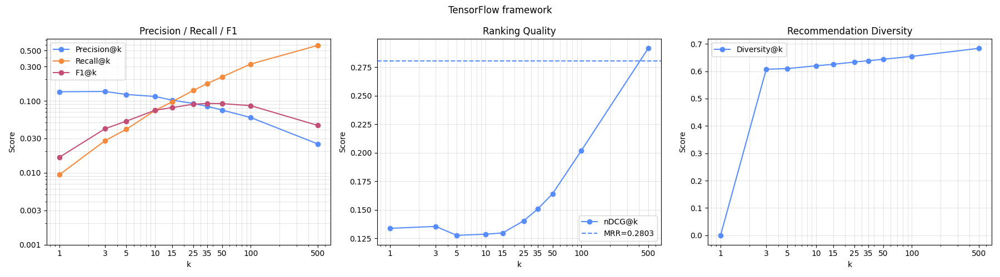
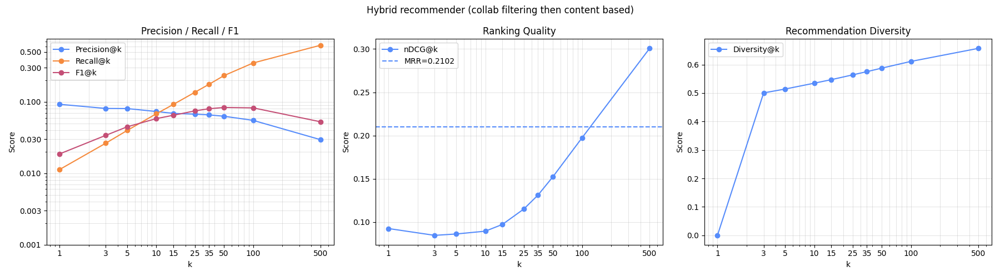

== 6. Recommender systems

Pro splnění úlohy byl použit dataset MovieLens (small varianta, dostupný
http://files.grouplens.org/datasets/movielens/ml-latest-small.zip[tady].

Dataset obsahuje následující soubory:

* `links.csv` -- mapování filmů na externí databáze, například IMDb.
* `ratings.csv`
** uživatelská hodnocení filmů v rozsahu od 0.5 do 5.0,
** celkový počet uživatelů: 610,
** počet filmů, které mají alespoň jedno hodnocení: 9724.
* `movies.csv`
** metadata o filmech,
** název filmu a seznam žánrů,
** celkový počet filmů: 9742.
* `tags.csv`
** uživatelské tagy, například `funny`, `scary`, `classic`.
V této práci byly využity pouze soubory `ratings.csv` a `movies.csv`.
(data z `links.csv` a `tags.csv` jsou ignorovaná).

=== Implementace
==== Content-based recommender
Content-based recommender vychází výhradně z obsahu filmů.

Pro každý film je vytvořen vektorový embedding na základě textové reprezentace,
která vznikne spojením názvu filmu a jeho žánrů. Použitý model pro embeddings je
`sentence-transformers/all-MiniLM-L6-v2`.

Profil uživatele je vytvořen jako průměr embeddingů všech filmů,
které daný uživatel ohodnotil alespoň hodnotou `rating_like_threshold`.
V této práci byla použita hodnota `3.5`.

Při generování doporučení je pro každý kandidátní film vypočtena kosinová podobnost
mezi embeddingem uživatele a embeddingem filmu.
Filmy jsou následně seřazeny sestupně podle této podobnosti a vracen top K seznam.

Implementace daného přístupu nalezneté v `src/content_based.py`.
// TODO: pros/cons
// always generates enough results, can recommend newer movies (as representations does not have to change)

==== Collaborative filtering recommender

Pro implementaci collaborative filtering recommenderu byl použit přístup User-User podobnosti.

Každý uživatel je reprezentován vektorem hodnocení všech filmů v datasetu (doplnené na nuly).
Podobnost mezi dvojicí uživatelů je následně počítána pomocí kosinové podobnosti.

Během implementace byla experimentálně ověřena také Pearsonova korelace.
Ta však nevedla ke zlepšení výsledků, proto byla finální implementace
omezena pouze na kosinovou podobnost.

Při generování doporučení se nejprve vybere
`top_users_to_consider` nejpodobnějších uživatelů k cílovému uživateli (`10`).
Příčemž živatelé s podobností menší nebo rovnou nule jsou ignorováni,
proto může být skutečný počet použitých sousedů menší než zadaná hodnota.

Z hodnocení těchto podobných uživatelů jsou následně vybrány filmy,
které cílový uživatel dosud nehodnotil. Predikované skóre filmu je vypočteno jako vážený průměr
hodnocení podobných uživatelů, kde vahou je podobnost daného uživatele
k cílovému uživateli (vzorec z přednašky):

[latexmath]
++++
\hat{r}(u, i) =
\frac{
\sum\limits_{v \in N(u)}
s(u, v) \cdot r(v, i)
}{
\sum\limits_{v \in N(u)}
s(u, v)
}
++++

kde:

* `u` je cílový uživatel,
* `i` je doporučovaný film,
* `N(u)` je množina nejpodobnějších uživatelů,
* `s(u, v)` je podobnost mezi uživateli `u` a `v`,
* `r(v, i)` je hodnocení filmu `i` uživatelem `v`.

Filmy jsou následně seřazeny podle vypočteného skóre sestupně.

Implementace daného přístupu nalezneté v `src/collaborative_filtering.py`.

==== Hybrid recommender

Pro implementaci hybridního recommendru byly použity dva přístupy
doporučené v zadání:

. primární doporučení pomocí content-based recommenderu a následné přeřazení výsledků pomocí collaborative filtering,
. změná pořadí přístupů v 1.

Při použití pouze jednoduchého přeřazení `top_k` výsledků z prvního doporučovače
nebylo dosaženo výrazného zlepšení oproti samostatným modelům.
Důvodem je omezený počet kandidátů, mezi nimiž může druhý model měnit pořadí.

Z tohoto důvodu byla implementace rozšířena o parametr `enlarge_candidate_pool_times` (použita hodnota `3.5`)
Požadovaný počet doporučení `top_k` je před spuštěním prvního modelu
vynásoben tímto koeficientem.

Tyto kandidáty jsou následně ohodnoceny druhým modelem.
Výsledné skóre každého filmu je určeno jako aritmetický průměr
normalizovaných skóre (do <0, 1>) obou modelů.

Filmy jsou poté seřazeny podle výsledného kombinovaného skóre
a vráceno je prvních `top_k` položek.

Implementace daného přístupu nalezneté v `src/hybrid.py`.

==== TensorFlow Recommenders

Pro implementaci tohoto přístupu byla použita knihovna
TensorFlow Recommenders (TFRS) a její základní retrieval model
podle oficiálních příkladů v dokumentaci.

Cílem trénování modelu je naučit embeddingy uživatelů a filmů tak,
aby uživatel, kterému se určitý film líbí, měl vysokou podobnost
s embeddingem tohoto filmu.

Trénovací data tvoří dvojice `(userId, movieId)`,
které reprezentují pozitivní interakce.
Do trénování jsou zahrnuta pouze hodnocení splňující podmínku:

* `rating_like_threshold = 3.5`

To znamená, že model pracuje pouze s filmy,
které uživatel hodnotil pozitivně.

Použité parametry trénování:

* `embedding_dim = 64`
* `epochs = 5`
* `batch_size = 1024`
* `learning_rate = 0.05`

Tyto parametry byly zvoleny na základě jednoduchých experimentů
a byly zaznamenány také do systému MLflow.

Při doporučování filmů se následně postupuje podobně jako u content-based přístupu.
Pro každého uživatele je nejprve získán jeho naučený embedding a pro všechny kandidátní
filmy jsou vypočteny skóre jako skalární součin embeddingu uživatele a embeddingu filmu.

Implementace daného přístupu nalezneté v `src/tf_framework.py`.

=== Hodnocení modelů

Pro vyhodnocení kvality doporučovačů byly použity následující metriky:

* Precision@ -- podíl relevantních filmů mezi prvními `K` doporučenými položkami.
* Recall@K -- podíl relevantních filmů z testovací množiny, které se objevily mezi prvními `K` doporučeními.
* F1@K -- harmonický průměr Precision@K a Recall@K.
* MRR -- průměrná převrácená hodnota pozice prvního relevantního filmu.
* nDCG@K  -- hodnotí kvalitu pořadí doporučení, přičemž relevantní položky na vyšších pozicích mají větší váhu.
* Diversity@K -- (1 - průměrná podobnosť doporučených filmů),
* Coverage@K
 -- podíl unikátních filmů, které se objevily v doporučeních alespoň jednoho uživatele, vůči celkovému počtu filmů v datasetu.

Diveristy byla vypočtena jako `1 - cosine similarity` mezi embeddingy filmů vytvořenými z názvu a žánrů. Byl použit
stejný model jako při Content based přístupu.

Všechny metriky kromě MRR byly počítány pro více hodnot `K`:
`1, 3, 5, 10, 15, 25, 35, 50, 100, 500`.

NOTE: Relevantními položkami byly filmy z testovací části datasetu s hodnocením alespoň `3.5`.

NOTE: Někteří uživatelé byli z evaluace vyřazeni, pokud v testovací množině neměli žádný relevantní film.

NOTE: Pokud doporučovač vrátil méně než požadovaných `K` výsledků, byly metriky Precision@K, Recall@K, F1@K, nDCG@K i Coverage@K
  počítány vzhledem k požadovanému `K`, což takové případy penalizuje. U metriky Diversity@K byla použita pouze skutečně vrácená doporučení.

NOTE: Pro vytvoření trénovací a testovací množiny byly ratingy každého uživatele rozděleny v poměru 0.7 : 0.3 (test).

=== Výsledky evaluace

Tabulka níže shrnuje hlavní výsledky všech implementovaných přístupů pro hodnoty `K = 10` a `K = 25`.
V každé buňce jsou uvedeny dvě hodnoty ve formátu `@10 / @25`. 
Dané metriky taky můžete sledovat v MLflow. Grafy metrik @K a kompletní výsledky (v JSON) jsou 
přídané do adresaru `results` a MLflow artefaktů.

Kód pro ohodnocení modelů -- train/test split, vypočet metrík a další pomocné funkce pro hodnocení nelezneté v `src/evaluation.py`.

[cols="2,1,1,1,1,1,1", options="header"]
|===
|Metoda
|Precision
|Recall
|F1
|nDCG
|Diversity
|Coverage

|Content-Based
|0.0271 / 0.0216
|0.0190 / 0.0387
|0.0182 / 0.0221
|0.0327 / 0.0368
|0.3936 / 0.4226
|0.0882 / 0.1594

|Collaborative Filtering
|0.0388 / 0.0383
|0.0310 / 0.0803
|0.0276 / 0.0423
|0.0458 / 0.0619
|0.6780 / 0.6826
|0.1355 / 0.1918

|Hybrid (Content -> Collaborative)
|0.0340 / 0.0278
|0.0270 / 0.0531
|0.0239 / 0.0290
|0.0429 / 0.0497
|0.4312 / 0.4552
|0.0656 / 0.1211

|Hybrid (Collaborative -> Content)
|0.0734 / 0.0674
|0.0682 / 0.1363
|0.0584 / 0.0749
|0.0895 / 0.1151
|0.5346 / 0.5639
|0.1100 / 0.1821

|TensorFlow Recommenders
|0.1150 / 0.0921
|0.0735 / 0.1391
|0.0740 / 0.0897
|0.1288 / 0.1405
|0.6198 / 0.6335
|0.1294 / 0.1922
|===

==== Shrnutí výsledků

Z dosažených výsledků je patrné, že nejlepší kvality doporučení dosáhl model implementovaný pomocí TensorFlow Recommenders.
Tento přístup dosáhl nejvyšších hodnot metrik Precision, F1 i nDCG a zároveň si zachoval vysokou diverzitu doporučení.
Průběh metrik dle @K je vidět na obr níže:

Z grafu je patrný výrazný růst metriky nDCG s rostoucí hodnotou `K`.
To naznačuje, že model sice relevantní filmy často nalézá, ale ne vždy je umisťuje na úplně nejvyšší pozice doporučeného seznamu.
S rostoucím počtem vrácených výsledků se proto zvyšuje pravděpodobnost, že se relevantní filmy objeví.

Je vhodné zdůraznit, že dosažené hodnoty metrik nejsou přímo srovnatelné s klasifikačními úlohami.
Výběr relevantních filmů je relativně obtížný problém, protože pro každého uživatele je z několika tisíc filmů relevantní pouze malá podmnožina.
V testovací množině měl typický uživatel pouze několik desítek filmů s hodnocením alespoň `3.5`,
zatímco celkový počet filmů v datasetu přesahuje 9700.

Model TensorFlow Recommenders byl navíc trénován pouze na binární informaci o tom,
zda uživatel film hodnotil kladně (`rating >= 3.5`) či nikoliv. Pro zlepšení výsledků
určíte by se dalo využit informace o uživateli (tagů na filmy) a metadat filmů.

Velmi dobrých výsledků dosáhl také hybridní přístup ve variantě Collaborative pak Content, 
který ve všech sledovaných metrikách výrazně překonal samostatné content-based i collaborative filtering modely.
Pro porovnaní níže uvádím grafy metrik pro daný model.

Samostatný collaborative filtering poskytl lepší výsledky než content-based přístup, zejména z pohledu recall, diversity a coverage.

Hybridní varianta Content -> Collaborative nepřinesla významné zlepšení oproti samotnému content-based modelu. 
To pravděpodobně souvisí s tím, že první fáze generovala omezenou množinu kandidátů, která již neobsahovala dostatek relevantních filmů.

=== Spuštění a MLflow

Pro vytvoření prostředí a instalaci závislostí:

[source,bash]
----
pyenv install 3.12.11
pyenv local 3.12.11
python -m venv .venv
source .venv/bin/activate
pip install -r requirements.txt
----

Pro spuštění experimentů slouží Jupyter notebooky v adresáři `notebooks/`.
Hlavní notebook `main.ipynb` postupně natrénuje všechny implementované doporučovací
systémy, vyhodnotí je a uloží výsledky do adresáře `outputs/`.

IMPORTANT: Před spuštěním `main.ipynb` musí být dostupný MLflow server na adrese `http://localhost:5000/`.

Pro každý model jsou zaznamenány:

* parametry experimentu:
** `model_type`
** `dataset_name`
** `split_strategy`
** parametry konkrétního modelu (např. `embedding_dim`, `epochs`, `learning_rate`)
* metriky:
** Precision@K
** Recall@K
** F1@K
** nDCG@K
** Diversity@K
** Coverage@K
** MRR
* pomocné statistiky:
** `train_size` (70316)
** `test_size` (30520)
** `below_required_recommendations`
** `dropped_users_count` -- více v sekci o hodnocení (nemají relevantních filmů v test sadě)
** `train_duration_seconds`
** `avg_query_time_500_seconds`
* artefakty:
** JSON soubory s kompletními výsledky
** grafy metrik

Do MLflow byly dále uloženy i případné další metriky relevantní pro konkrétní model.

Kompletní výsledky všech experimentů jsou dostupné jak v MLflow, tak ve formátu JSON
v adresáři `results/`.
